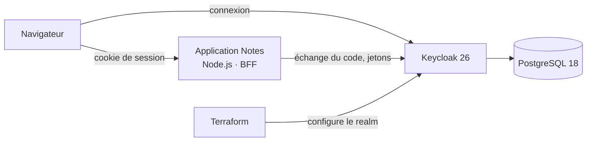
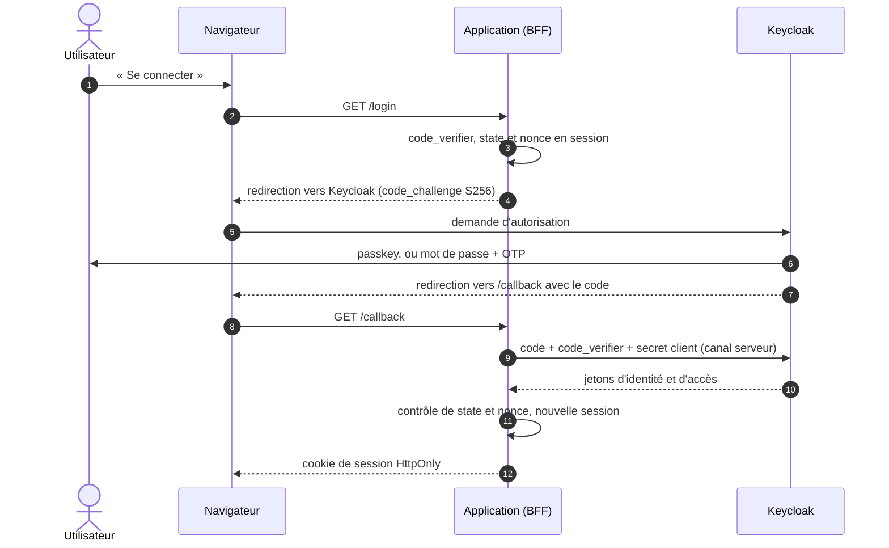

# Keycloak IAM Lab — authentification moderne, configurée en code

[](https://github.com/Jhanemba64/keycloak-iam-lab/actions/workflows/ci.yml)

Laboratoire de gestion des identités : **Keycloak 26** en mode production, un realm entièrement
décrit en **Terraform**, une application protégée en **OpenID Connect** selon le modèle **BFF**, la
connexion par **passkey** ou **mot de passe + OTP**, et des **tests de bout en bout** qui vérifient
la sécurité dans un vrai navigateur.

Un seul `./lab.sh up` démarre l'ensemble et applique toute la configuration.

## Ce que montre ce laboratoire

- **Configuration en code** : realm, politique de sécurité, flux d'authentification, rôles, groupes,
  client OIDC et comptes de test sont déclarés en Terraform (provider officiel `keycloak/keycloak`).
- **Authentification forte** : passkey (WebAuthn, vérification de l'utilisateur obligatoire), ou mot
  de passe suivi d'un code OTP imposé dès la première connexion.
- **Flux d'authentification sur mesure**, avec des références AMR exactes : l'application sait si
  l'utilisateur s'est connecté par passkey (`hwk`) ou par mot de passe + OTP (`pwd`, `otp`).
- **OIDC en modèle BFF** : flux Authorization Code avec PKCE, jetons conservés côté serveur, cookie de
  session HttpOnly pour le navigateur.
- **Autorisation par rôles** (RBAC) attribués par groupe, rôle composite, jetons limités aux rôles
  utiles au client.
- **Sécurité vérifiée par des tests**, pas seulement déclarée : PKCE, redirections, anti-force brute,
  passkeys…

## Architecture



Le flux de connexion, du clic au cookie de session :



Les jetons ne quittent jamais le serveur de l'application : un script injecté dans la page ne peut pas
les voler.

## Démarrage

Prérequis : Docker (avec Compose), Terraform 1.9 ou plus, bash et openssl (Git Bash suffit sous Windows).

```bash
./lab.sh up          # secrets générés dans .env, Keycloak, Terraform, application
./lab.sh passwords   # mots de passe des comptes de test
./lab.sh test        # tests de bout en bout (Playwright dans Docker)
./lab.sh down        # arrêt ; ./lab.sh reset repart de zéro
```

- Application : http://localhost:3000
- Comptes : `alice` (groupe *lecteurs*) et `bob` (groupe *administrateurs*). L'OTP est demandé à la
  première connexion : scannez le QR code avec FreeOTP, Google ou Microsoft Authenticator. Une passkey
  peut ensuite être ajoutée depuis l'application.

## Politique de sécurité du realm

| Domaine | Réglage | Pourquoi |
|---|---|---|
| Client OIDC | confidentiel, Authorization Code seul, PKCE S256 obligatoire | pas de flux implicite ni d'échange direct identifiant / mot de passe |
| Redirections | adresses exactes, sans joker | empêche le détournement du code d'autorisation |
| Jetons | accès 5 min, refresh token à usage unique, session SSO 30 min d'inactivité, 10 h maximum | limite la durée d'exploitation d'un jeton volé |
| Portée des jetons | `full_scope_allowed = false`, rôles attribués explicitement au client | le jeton ne porte que les rôles dont l'application a besoin |
| Mots de passe | 12 caractères, 4 types de caractères, différent de l'identifiant et de l'email, 5 derniers interdits | |
| Force brute | blocage après 5 échecs, durée croissante jusqu'à 15 min, message d'erreur neutre | ne révèle pas si un compte existe ou est bloqué |
| Passkeys | clé découvrable, vérification de l'utilisateur obligatoire | la passkey vaut deux facteurs : possession et biométrie ou code |
| En-têtes | CSP, `X-Frame-Options`, HSTS, `nosniff`, `Referrer-Policy` | côté Keycloak comme côté application |
| Session applicative | cookie HttpOnly, SameSite=Lax, identifiant régénéré après connexion | protège contre le vol et la fixation de session |

## Flux d'authentification

```
navigateur-mfa
├── Cookie (session SSO déjà ouverte)                          ALTERNATIVE
└── formulaires                                                ALTERNATIVE
    ├── Identifiant / mot de passe, passkey proposée           REQUIRED
    ├── si une passkey a été utilisée                          CONDITIONAL
    │   └── référence AMR « hwk »
    └── si le mot de passe a été utilisé                       CONDITIONAL
        ├── référence AMR « pwd »
        └── si l'OTP est configuré : code OTP, AMR « otp »     CONDITIONAL
```

Le formulaire unique ne révèle pas si un compte existe, contrairement à un formulaire « identifiant
d'abord ». Le claim `amr` (RFC 8176) permet à l'application d'exiger, par exemple, une passkey pour
une action sensible.

## Tests de bout en bout

Les tests [Playwright](tests/e2e) tournent dans un vrai Chromium, contre le laboratoire démarré :

| Test | Ce qu'il prouve |
|---|---|
| Première connexion d'alice | l'OTP est imposé, alice n'a que le rôle lecteur, `/admin` répond 403 |
| Connexion de bob | le rôle composite administrateur donne accès à l'administration |
| Connexion suivante d'alice | mot de passe et OTP (`amr` = `otp pwd`), puis déconnexion qui ferme aussi la session Keycloak |
| Passkey | enregistrement par un authentificateur virtuel, puis connexion sans mot de passe ni OTP (`amr` = `hwk`) |
| Force brute | après 5 échecs, même le bon mot de passe est refusé |
| PKCE | une demande d'autorisation sans `code_challenge` est rejetée |
| Redirection | une adresse de retour non déclarée est refusée |
| Échange direct | le flux « mot de passe » est désactivé pour le client |

Un script de préparation remet les comptes de test à zéro par l'API d'administration : les tests sont
rejouables à volonté.

## Intégration continue

Le workflow [`ci.yml`](.github/workflows/ci.yml) vérifie à chaque push :

- le Terraform (`fmt`, `validate`, TFLint) ;
- l'application : Hadolint, Checkov, audit des dépendances npm, scan Trivy de l'image (image multi-étapes
  `node:24-alpine`, sans npm, exécutée sans les droits root) ;
- le **laboratoire complet** : démarrage, configuration Terraform, puis les tests de bout en bout.

Les actions GitHub sont épinglées par SHA de commit, et Dependabot propose chaque mois les mises à jour
compatibles.

## Limites du laboratoire

Ce qui serait différent en production :

- **TLS** partout : ici tout reste sur `localhost` en HTTP, ce que Keycloak accepte pour les adresses locales ;
- un **compte d'administration dédié** pour Terraform, à la place du compte de service temporaire créé
  au premier démarrage ;
- un **backend Terraform distant et chiffré** : l'état local contient les mots de passe de test ;
- un **stockage de sessions partagé** (Redis…) pour l'application, et plusieurs instances de Keycloak ;
- une **messagerie** pour la réinitialisation des mots de passe et la vérification des emails.

## Licence

[MIT](LICENSE)
